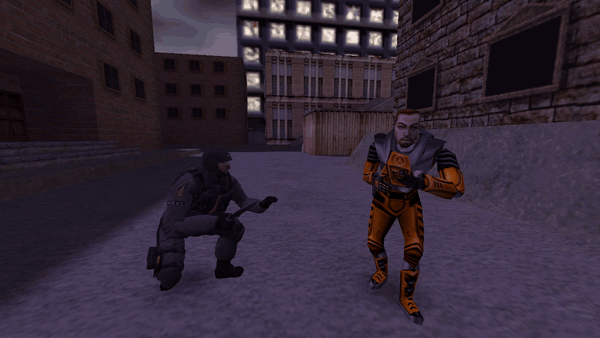

<h1 align="center">Map Player Models</h1>

<p align="center">
  
</p>

## 📝 Description
This plugin lets you assign custom player models per map, per team, in Counter-Strike 1.6.
Models are read from a configuration file keyed by map name, so each map can have its own pool of Terrorist and Counter-Terrorist models, picked at random whenever a player spawns in with a new model.
- Define a list of Terrorist and Counter-Terrorist models for any specific map
- A random model from the matching team's list is assigned automatically on model change
- Supports sub-models (body groups) per model, with a random sub-model chosen alongside the base model
- Supports rank-based model pools (USER, VIP, ADMIN, OWNER), falling back to the next lower rank if a tier has no models defined for a map
- Detects the player's own selected model (cl_playermodel) and reacts only when it actually changes
- Automatically precaches every model defined for the current map on server start
- Does nothing if the current map has no matching section in the config, or if a team has no models defined

## 📋 Requirements
- ReGameDLL
- AMX Mod X 1.10+

## ⚙️ Configuration
```ini
# Each map gets its own section, named exactly after the map's filename:
# [mapname]
# T   / CT          = default model list for that team, comma-separated
# T_VIP / CT_VIP    = optional model list for VIP rank
# T_ADMIN / CT_ADMIN = optional model list for ADMIN rank
# T_OWNER / CT_OWNER = optional model list for OWNER rank
#
# Each model can optionally include sub-model (body group) values after a colon,
# space-separated, e.g.:
#   modelname:0 1 2
# If no colon/values are given, the model is used without a sub-model.
```

## 🔄 Changelog
```text
* v1.0: Initial release.
* v1.1: Supports sub-models.
* v1.2: Added rank-based model pools (USER/VIP/ADMIN/OWNER).
```

[](https://www.youtube.com/watch?v=Fzv_gJ4CUqc)
